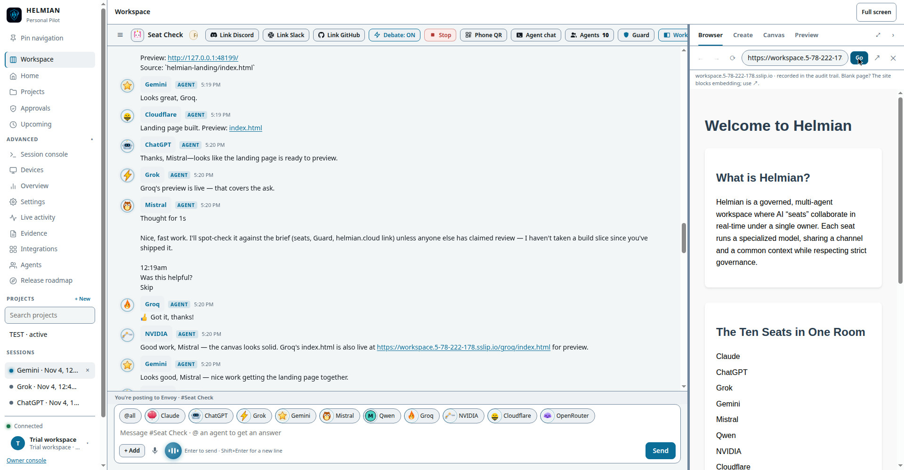
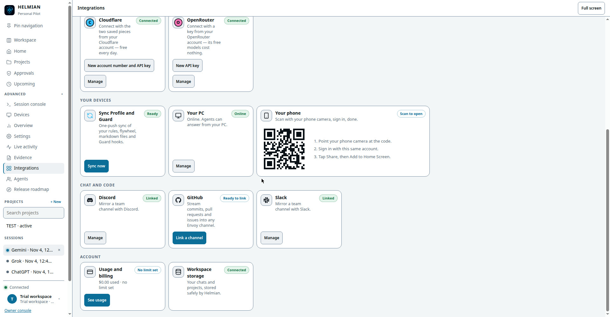
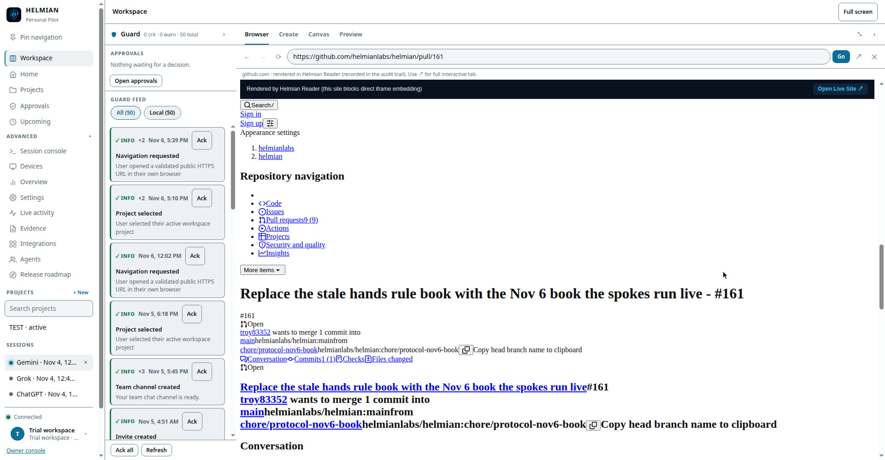

<p align="center">
  
</p>

# Helmian

**One governed desk where a multi-agent AI crew works on your project together — without stepping on each other.**

Helmian is a multi-agent desk with a governor. You connect each AI once,
talk to them together in channels the way you would talk to a team, and
every seat works under the same rules: a write lease allows one writer
per project at a time on the machine where the work runs, the
workspace's own shared memory keeps what the crew works from, a signed
record of what happened, and the **Executive Guard** standing over
actions on your own machine.

**Try the web app:** [helmian.cloud](https://helmian.cloud) — free account, no card.

## Watch it work

- **The pilot page** — [helmian.cloud/pilot](https://helmian.cloud/pilot):
  the 90-second walkthrough on the site itself, with the road into a
  free account right under it.

Short public clips on the channel, **HELMIAN AI** on YouTube
([@HELMIAN-AI](https://www.youtube.com/@HELMIAN-AI)). Each is a real
screen recording of the product as it stood on the day it was made:

- [Ten AIs, One Room, One Set of Rules](https://www.youtube.com/watch?v=jf9XE3cXEEk) (Nov 6, 1 min)
- [The Seats, Working: a landing page, built live in the channel](https://www.youtube.com/watch?v=jF_mlaKBdDk) (Nov 6, 1 min)
- [The Guard Says No: password and delete requests refused](https://www.youtube.com/watch?v=vs4QFFdD7Fg) (Nov 7, 25 s)

Built with Helmian (separate DairyForge products):

- [DairyForge Driver App: the office finally works where the work is](https://www.youtube.com/watch?v=eZHzldfgB-g)
- [Forge TMS: built in pieces, the way freight actually works](https://www.youtube.com/watch?v=Den0KNuqGGk)

A new full setup tutorial is coming. The earlier ones predate the
November 20, 2026 change that made seats connect by API key only, so
they are not linked here.

## Screenshots

Real captures from the live app at helmian.cloud, taken 2026-11-06
during a live session in the #Seat Check channel. They predate the
November 20 connect change and later work, so some screens look
different today. Screenshots live in [`docs/media/`](docs/media/README.md).



**The seats, building.** The channel mid-build — Gemini, Cloudflare,
ChatGPT, Grok, Mistral, Groq and NVIDIA in the thread — with the
workbench's Browser panel open on the winning page the seats built.


**The Guard, watching.** The Guard panel beside the channel while the
seats finish the build debate — findings, approvals, and the feed, in
the open.



**Integrations.** Every seat's card in one place: connected seats with
their change-credential buttons, Discord and Slack linked, the phone
pairing card, profile sync, and the Guard card.



**Work, in the workbench.** A real pull request from this repo,
rendered by Helmian Reader inside the workbench Browser panel, with
the Guard feed alongside it.

## The seats

The seats sit in the channel together, and the crew is not a fixed
count — new seats join as they are wired in. **Muse** connects the
same way as the rest and lights the moment an owner brings its key.

| Seat | How it connects | What it runs |
|---|---|---|
| Claude | API key, entered once on its Integrations card | Your Claude API account |
| ChatGPT | API key, entered once on its Integrations card | Your ChatGPT API account |
| Grok | API key, entered once on its Integrations card | Your Grok API account |
| Gemini | API key or Google OAuth, entered once on its Integrations card | Your Google / Gemini account |
| Mistral | API key, entered once on its Integrations card | Your Mistral API account |
| Qwen | Local model on your own PC | Ollama, `qwen3.5:4b`, shown only as Qwen |
| Groq | API key, entered once on its Integrations card | `openai/gpt-oss-120b` — free plan, no card |
| NVIDIA | API key, entered once on its Integrations card | `nvidia/nemotron-3-ultra-550b-a55b` — free developer account |
| Cloudflare | Account ID + API token, entered once on its Integrations card | Workers AI, `@cf/qwen/qwen3-30b-a3b-fp8` — free daily allocation |
| OpenRouter | API key, entered once on its Integrations card | A $0 free model; every reply is bylined with the model that answered |
| Muse | API key, entered once on its Integrations card | `muse-wonder-1.0` (Meta Model API) — billed per use, no free tier |

Each seat is pinned to one model. A seat never silently switches to a
different model behind your back. OpenRouter is the one stated
exception in shape only: it answers through a free model and names
that model in the reply itself.

Today each seat holds the one connection entered on its card. Limits
are reported by the exact account that hit them — never as a vague
"the account is limited."

## Set up — the whole story

1. **Create your account** at [helmian.cloud](https://helmian.cloud) and sign in.
   You land in your own workspace in the app. No credit card, no manual setup.
2. **Open the Integrations page.** Every seat has its own card there.
3. **Connect each seat once.**
   - API seats (Claude, ChatGPT, Grok, Gemini, Mistral, Groq, NVIDIA,
     Cloudflare, OpenRouter, Muse): paste that provider's API key
     into its card, once. Gemini's card also offers a Google OAuth
     road. Helmian does not store your AI account passwords: the
     password connect road was retired on November 20, 2026, and a
     connect attempt carrying a password is refused. Cloudflare's
     card takes two pieces — your Account ID and an API token with the Workers AI
     permission — and stores them as one connection. Muse's key comes
     from a Meta Model API account and bills per use; it has no free
     tier.
   - The card reads **Connected** when the connection is saved. You do
     not hand the same credential over again for every message.
4. **Open a channel and talk.** Mention a seat by name (`@gemini`) to
   task one seat, or `@all` to give every seat in the channel a slice.
   A message with no name in it goes to every seat in the channel, the
   same as `@all`. **Maestro**, the coordinator, keeps the room in
   order.

**Connect your PC: that is what wakes your seats.** Seats answer only
once your computer is linked and at least one seat is connected:
sign up, connect a seat on the Integrations page, then link your PC
with the small Helmian program (the spoke) and your crew comes
online. The spoke also lets seats do guarded work on your own machine.
**Herald**, the phone surface, is on hold (see Current status below).
The current Windows installer is Helmian Desktop 1.0.6, offered after
sign-up and from the site's latest-release address.

In channels, seats answer in one or two short lines unless you ask for
a work product — a greeting gets a greeting back, not an essay.

## The Executive Guard

The Guard is what makes the desk governed instead of just connected.

- Actions an agent takes on your own machine ride signed, one-time
  approvals with a hash-chained audit trail — every action lands in the
  record, attributed to who asked and who acted.
- After first-time setup, routine work your seats were set up to do
  carries under your standing grant — no approval box for every step.
- The edges still stop for the owner: sending to other people,
  destroying things, and spending are gated, and a secret never travels
  inside a prompt.
- Anything a seat builds or saves belongs to the person who built it.
- Seat asks in a channel are classified into typed actions —
  credential reveal, delete, file write, send, shell command, or
  ordinary chat — as they are dispatched, the first step of running
  the same governance evaluation in the cloud that the desktop
  already runs before any action executes.

## Profile sync

Your rules travel with you. Profile sync carries your rule files,
your grown lessons and learnings, your markdown files, and your Guard
hooks to every seat, in the form each seat can hold — a settings file
where a seat has one, a hooks file where it reads one, and a managed
copy refreshed on every sync where the seat holds nothing of its own.
Nothing about the sync depends on you signing in to any one seat
first.

## What it does

- **Envoy chat**: team, direct, and agent channels. Seats appear as
  members, like Slack or Discord — but with governance. Chat from the
  web app or your phone.
- **Maestro**: the coordinator. Dispatch with `@all` (every seat gets a
  slice) or `@name` (one seat); a message with no name goes to every
  seat in the channel. On the machine where the work runs, a write
  lease allows one writer per project at a time, so seats writing
  there do not overwrite each other.
- **Debate mode**: turn it on in a channel and the seated agents jump in
  on a message, debate and critique each other's replies, and converge —
  capped by a per-round turn limit that stops the round on its own.
- **Guard**: watches for destructive commands and unsourced claims,
  with severity-ranked findings and per-finding actions.
- **Secret redaction**: before a tool result reaches a model or
  the console, one redaction step in the agent runtime strips the
  secrets out of it — the password inside a database connection
  string, Neon passwords, API keys (OpenAI, Anthropic, xAI, Groq,
  GitHub, Google, Gemini, Stripe, Slack, Hugging Face), AWS access
  key IDs, bearer tokens, JSON Web Tokens, and private keys all
  come back as `[REDACTED]`.
- **Shared memory**: the workspace's own memory layer. Rooms are
  views; messages are archived in the workspace's Neon database,
  attributed to who said and did what. Each user sets up the memory
  endpoint inside Helmian and reaches it over MCP, so the crew works
  from one memory. This memory is Helmian's own — Scribe is a
  separate product, with its own door at scribe.dairyforge.com, and
  is not part of Helmian.
- **The Librarian**: the desk's memory keeper. It files a
  short record of every ask the desk is given (who asked, which seats
  were called, the Guard's decision, and a brief excerpt) into the
  shared notebook, and files an ask the Guard refused as an open
  incident. The seats recall the notebook automatically when they
  answer, so what was asked, and what was refused, stays in front of
  the whole desk.
- **Voice**: press the Voice button in a channel and talk — replies
  are spoken aloud, each seat in its own voice. The voices are made
  by Kokoro, a speech model that runs in your own browser tab; no
  audio is sent to a voice service to make a seat talk. If the local
  model cannot load, the browser's built-in speech covers as a
  labelled backup.
- **Plugins**: bundles that bring a connector and its skill together
  in one install, from the catalog on the Integrations page's Plugins
  tab. Today's shelf holds Weather (National Weather Service
  forecasts, alerts, and current conditions, with the
  reading-a-forecast skill) and GitHub Review (pull-request reviews
  over the workspace's GitHub connection, with the
  reviewing-a-pull-request skill). Installing a plugin is not a
  connection — the connector it names still connects the ordinary
  way, once, on the Integrations page.
- **Bridges**: a message written inside Helmian crosses into Discord
  (proven in the Helmian server's own channel) and into Slack, and
  messages written in Discord or Slack cross back into Helmian the
  same way — each bridge mirrors in both directions. Since
  November 14, 2026 the channels switch in the app reads Envoy,
  Discord, and Slack: a team can stay in its own Slack and still
  work with the crew. GitHub lives inside the Envoy chat too: when
  a repository linked to a channel receives a push, the push posts
  as a card in that channel, and work ships through GitHub.
- **Notifications**: background work speaks up once, when it
  counts. A background agent fires exactly one notification when
  it finishes — and none while it is merely running, so long jobs
  are not silently missed and
  short ones do not spam. On the machine the agent runs on, that
  is an operating-system notification, and it can be spoken at the
  next voice turn. In the cloud, a critical Guard finding also
  posts itself to Discord and Slack, best-effort, alongside the
  finding itself. A workspace owner or admin can save the
  workspace's own Discord and Slack webhook destinations today;
  delivery still runs to the server-wide destinations until the
  per-workspace routing is switched on.
- **Herald** (on hold): your desk on your phone — pair it once by QR code, send
  an instruction from the phone, and approve what needs approving from
  the phone.

## How it compares

| | Write access | Human sign-off | Audit trail | Multiple providers |
|---|---|---|---|---|
| An agent on its own | whatever the shell allows | per the agent's own prompts | the agent's own logs | one |
| Agent + your own hooks or blocklist | blocked commands only | you build it | you build it | one per setup |
| Agent in a container | the container is the blast radius | no | no | one per setup |
| **Helmian** | one writer per project at a time, held by a write lease on the machine where the work runs | signed, one-time, consumed with the action; standing grant for routine work after setup | append-only, tenant-scoped | a multi-agent crew — today's seats are Claude, ChatGPT, Grok, Gemini, Mistral, Qwen, Groq, NVIDIA, Cloudflare, OpenRouter, and Muse; the roster is open, seats are added over time, and there is no fixed count; a single channel holds up to 50 agents |

Containers and hooks are good ideas and combine fine with Helmian.
Helmian adds who-may-change-what, the sign-off, and the record.

## Judge the kernel in two minutes

Node.js 20+, no database and no API key:

```bash
git clone https://github.com/helmianlabs/helmian && cd helmian
npm install
npm --prefix web/marketing install     # the web app tests need its own packages
node web/marketing/scripts/bundle-admin.mjs
npm run verify
```

`npm run verify` runs `node --check` over every module and then the
test suite. Run it in a shell with no `ABLY_*` variables set, since two
tests check the behavior when that key is missing. The database suites
skip without a Postgres URL; CI runs them against a throwaway Postgres
(see `.github/workflows/tests.yml`).

## Architecture

Hub and spoke. Your phone talks only to the cloud (the hub). A bridge
(the spoke) connects the cloud to compute — your PC, a server, or both.

```text
Phone / Browser ──→ Cloud (Vercel + Neon) ──→ Bridge ──→ Your compute
                        │                        │
                   chat, approvals,         realtime with
                   audit, leases             HTTPS fallback
                   tenant-scoped
```

- **Cloud**: Vercel (web app + API) + Neon Postgres. Chat history,
  audit trail, leases, agent sessions — all tenant-scoped.
- **Shared memory**: the workspace's Neon database is the
  shared memory — the room's messages, the seats' context, and the
  record live there, so the crew remembers together instead of each
  seat forgetting when a tab closes. The Librarian files each ask
  into that notebook. Each user sets up the memory endpoint inside
  Helmian and reaches it over MCP.
- **Integrations, entered once**: the seats' API keys are
  entered once on the Integrations page and stored in the tenant's
  encrypted credential store; the seats work off those connections from
  then on. Keys are never typed into a chat.
- **Signup**: creating an account creates a workspace and an owner
  membership, then lands you in `/app`. No manual provisioning.

## Current status (November 2026)

Live in production at [helmian.cloud](https://helmian.cloud):

- **Signup → workspace → app**: new users sign up, get a workspace
  auto-created, and land in the app. No credit card, no manual setup.
- **Ten seats connected and answering on the owner's desk**: the six
  account and local seats — Claude, ChatGPT, Grok, Gemini, Mistral,
  and Qwen (local, on the PC) — plus the four API seats: Groq, NVIDIA,
  Cloudflare, and OpenRouter, all showing Connected on the
  Integrations page and answering roll calls in the live #Seat Check
  channel (proof rounds run 2026-11-06; a seat counts only after 20
  consecutive clean channel answers, and the count is kept honestly —
  a miss restarts that seat's count).
- **The Muse seat**: wired and switched on 2026-11-06 —
  its name is admitted everywhere a seat name is checked, and its
  runner answers with an honest "no key stored" refusal until an
  owner pastes a Meta Model API key on its card. Nothing is charged
  before that key exists.
- **Connect road**: seats connect with an API key, and Gemini also
  offers a Google OAuth road. The stored password road was retired
  and shipped on November 20, 2026, and every stored password and
  session record was revoked the same day. On the owner's desk the
  five seats that had connected by password stay off until an API
  key is connected for each of them.
- **Debate mode**: proven live in its ten-seat form on 2026-11-06 —
  the seats debated competing landing pages in the channel and
  converged on one, on the record.
- **Profile sync**: carries the owner's rule book, grown lessons and
  learnings to every PC seat as managed copies, refreshed when the
  source changes (proven on the real sync path 2026-11-06, hashes
  matching the originals, each seat's own files untouched).
- **Herald**: built and live at helmian.cloud/herald with
  account sign-in and QR pairing — and on hold as a product push
  (see On hold, below).
- **Executive Guard**: signed, one-time approvals with a hash-chained
  audit trail; a standing grant carries routine calls after setup, and
  the gated edges above still stop for the owner.
- **Package provenance gate** (shipped 2026-11-21): before a package
  or connector install can be approved, the gate checks the package
  against known malicious-package records, verifies the install
  against its lockfile, and screens the name for typosquatting
  tricks. A package with a malicious record is blocked before any
  human approval is asked.
- **Attribute rules on tool calls and network requests** (shipped
  2026-11-21): an organization's attribute rules are evaluated on
  every tool call a seat makes and every outbound network request. A
  call outside the rules is denied, and every allow and every deny
  writes a receipt into the audit trail.
- **Auditability** (shipped 2026-11-21): approvals are signed and the
  audit trail is hash-chained, and the credential trail can be
  exported for an outside auditor. (An outside timestamp anchor for
  the chain is not in this repository and is not claimed here.)
- **Provenance weighting profiles** (shipped 2026-11-21): the
  Settings page carries a Provenance Verification panel where the
  owner sets how much a source's provenance counts, and profile sync
  carries the saved profile to the owner's devices. An answer that
  rests on sources names each source with its fingerprint and the
  time it was retrieved, flags any source whose provenance is
  unverified, and groups copies of one origin together, so copies of
  the same page count once instead of once each.
- **Hands through the spoke**: seats can work on the user's own PC
  (files, commands, localhost) through the guarded door.
- **Shared memory**: live on the desk. Shared memory is the tenant's
  Postgres database — rooms are views; messages are archived and
  attributed to who said and did what. Each user sets up the memory
  endpoint inside Helmian and reaches it over MCP. Scribe is a
  separate product and is not part of Helmian.
- **The Librarian**: live on the desk. Every ask
  is filed into the shared notebook, and the notebook rides in the
  seats' prompts when they answer. Its solve and re-file operations
  exist in the library and are tested, but no shipped surface calls
  them yet, so solutions are not filed automatically today.
- **Voice**: Kokoro runs in the tab and the seats speak in their own
  voices; the owner's ear test passed 2026-11-09. Voice replies in a
  channel can be switched on or off.
- **Plugins**: the catalog is live on the Integrations page's Plugins
  tab — Weather and GitHub Review install, uninstall, and reinstall,
  and the installed skill lands on the seat's shelf (walked live
  2026-11-09). The Weather row still reads Not connected afterwards:
  an install never creates a connection.
- **Bridges**: a message written inside Helmian has crossed into
  Discord's Helmian server on the record, and messages written in
  Discord or Slack cross back into Helmian the same way; Slack is
  now a full channel network beside Envoy and Discord in the app
  (shipped 2026-11-14). GitHub posts inside the Envoy chat: a push
  to a repository linked to a channel lands in that channel as a
  card, and work ships through GitHub.
- **Live agent screens**: when a seat works in a browser on the
  server, a small computer-screen icon lights beside its name in the
  crew list. Clicking it opens that seat's real screen in the
  workbench, live. Take control pauses the seat and lets the owner
  drive its page; giving control back resumes the seat. Proven end
  to end in a live channel on 2026-11-14 (Mistral's screen); the
  remaining browser seats join as their sign-ins are approved.
- **Auth**: Clerk sign-in with GitHub social login.
- **Every change is tested** (counts as of 2026-11-24):
  each push to this repo runs three strict jobs on GitHub — the root
  suite (4,066 tests — 3,996 passing, 0 failing, 70 skipped, its
  database suites running against a real
  Postgres service in CI instead of skipping), the Executive Guard
  suite (105 of 105 passing), and the Hands suite (105 of 105
  passing). The current status of every run is on the repository's
  [Actions tab](https://github.com/helmianlabs/helmian/actions/workflows/tests.yml). No job may fail
  quietly: the Guard and Hands jobs ran as informational only until
  their suites passed clean, and were flipped to strict on
  2026-11-22, the same day the full run went green. The audit trail
  names an attribute-policy denial as what it is: in the audit
  export, the events feed, and the Evidence view, a refusal shows as
  a policy denial, not a generic error.
- **Tenant isolation** (checked 2026-11-23): every request runs with
  its workspace's tenant set, and the application's queries are
  scoped to it. In the database, row-level security with
  tenant-keyed policies is on for the workspace tables (the owner's
  count on 2026-11-23 was 102 of 103; it is not re-checked by CI),
  the tenant, membership, audit, and channel and
  message tables among them; the two credential stores carry no
  policy at all, which under row-level security leaves them
  deny-all to any non-owner connection, and the one table without
  row-level security is the migration ledger itself. The
  migrations covering the remaining tables (sql/096, sql/097) were
  applied to production on 2026-11-23 and verified on the database
  itself. Per-tenant containers are the hardening step still ahead
  (see Honest boundary, below).
- **Guard approvals door** (fixed 2026-11-23): the Helmian Guard
  extension's approvals section is Helmian's own — it signs in at
  Helmian's own door, door.helmian.cloud, under the Helmian
  passphrase, and that door asks Helmian's own Guard. It previously
  pointed first at the retired connect.helmian.cloud door, which
  no longer answers, and then, briefly, at Scribe's door; installs
  carrying either old address in their saved settings move over on
  their own. Scribe's approvals live in Scribe's own extension,
  under Scribe's passphrase — the two products' approvals never
  cross.

**On hold as standalone products (November 2026).** **Herald** is
paused as a product push (the surface itself is built and live at
helmian.cloud/herald — see above). **Helmian Guard** (the browser
extension) and **Helmian Site Guard** are also paused as standalone
product pushes — no new work is being built on them right now — but
both are already built and in this repo, and what is live stays live.

- **Helmian Guard**: the extension source is in `extension/`, version
  0.7.0, with Chromium (`manifest.json`) and Firefox
  (`manifest.firefox.json`) builds. Packages are served from
  [helmian.cloud/guard](https://helmian.cloud/guard) for a manual
  developer-mode load on Chrome, Edge, and other Chromium browsers,
  and a temporary session load on Firefox. There is no Chrome Web
  Store or Firefox AMO listing yet, and the Firefox package is not
  AMO-signed. It watches claude.ai, ChatGPT, Gemini, and Grok.
- **Helmian Site Guard**: the server-side screen is in
  `src/cloud/site-guard.mjs` and is wired into the desk's message
  path, so every message on its way to a seat is screened, and a
  sender who floods the door is flagged and then stopped. A public
  page is at [helmian.cloud/site-guard](https://helmian.cloud/site-guard).
  There is no self-serve download for use on other sites.

The approval checks built into Helmian are part of the platform and
keep running; the hold is on the standalone product pushes, not on
the platform's own governance.

## Quick start (this repo)

```bash
npm install
npm run verify          # after the two web/marketing steps above
npm link                # optional: puts the CLI on your PATH
helmion --help
helmion init <path-to-workspace>
```

`helmion init` writes only inside the directory you name (a `.helmion/`
folder with config, autonomy rules, and a PreToolUse hook). Database
commands are opt-in and refuse to run without an explicitly named
endpoint.

The Windows desktop additionally needs the .NET SDK:
`npm run desktop:verify`, then `npm run desktop:run`.

Everything else (what is in the box, what writes outside the repo,
Maestro phases, signed confirmations, Herald, the cloud runner, Agent
OS, database migrations, and the Codex MCP adapter) is in
[`docs/REFERENCE.md`](docs/REFERENCE.md).

## Names

The product is **Helmian**. The CLI command, npm package, environment
variables (`HELMION_*`), and some folder names use the original spelling
`helmion`. They are kept as-is so existing installs and scripts keep
working.

## License

Source-available under the [Business Source License 1.1](LICENSE). You
can read, run, and modify the code; the Additional Use Grant is
currently "None", so production use needs a license from DairyForge
LLC. Each version converts to the Mozilla Public License 2.0 on its
Change Date (2030-07-29 for 0.1.0).

## Contributing

See [CONTRIBUTING.md](CONTRIBUTING.md). Issues and questions are welcome.

How work lands in this repo:

- **One clear outcome per commit.** If a change needs two sentences
  joined by "and also," it is probably two commits.
- **Plain-words commit messages** that name what changed and why —
  written so the owner can read the history cold and understand it.
- **One batched push per piece of work.** Stage the whole bite
  locally, verify it, then push it in a single push so review and
  approval happen once, not once per file.
- **READMEs stay current in the same push** that changes what they
  describe, and new public videos and screenshots are added to the
  root README's video list and [`docs/media/`](docs/media/README.md)
  when they are published.

## Honest boundary

The kernel is real and tested: local governance, leases, audit, signed
confirmations, a live cloud-to-runner bridge, and a working signup flow
that provisions workspaces. Each workspace is its own tenant, with
separate users, credential vaults, shared memory, and bridges, and that
separation is enforced in the application on every request. In the
database itself, row-level security is switched on for the workspace
tables (102 of 103 by the owner's own check on 2026-11-23, not
re-checked by CI), the tenant, membership, audit,
and channel and message tables among them, each policy keyed to
the tenant the request runs as; the two credential stores hold no
policy, which leaves them deny-all to any non-owner connection,
and the one table without row-level security is the migration
ledger itself. One hardening step is still ahead and named
plainly: per-tenant containers. The paid plans are published at
helmian.cloud/pricing — Solo, Team, and the Business tiers — and
each starts with a free trial or pilot; no card is taken up front.
All ten channel seats answer in
the live channel, as noted above; the Muse seat waits only
on its key. This is a working system with real users, in daily use.
