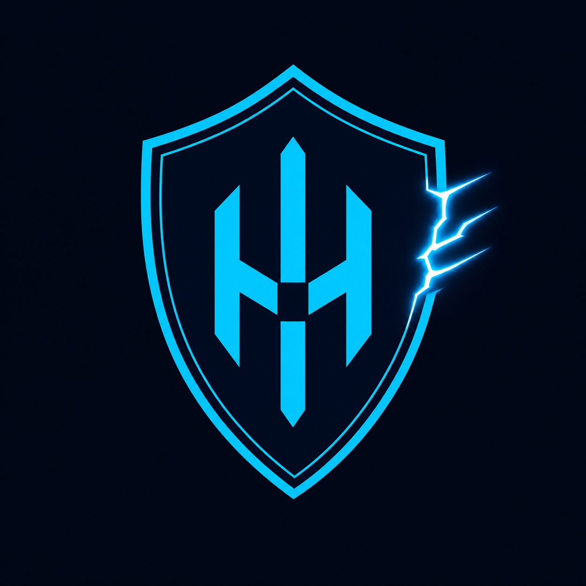
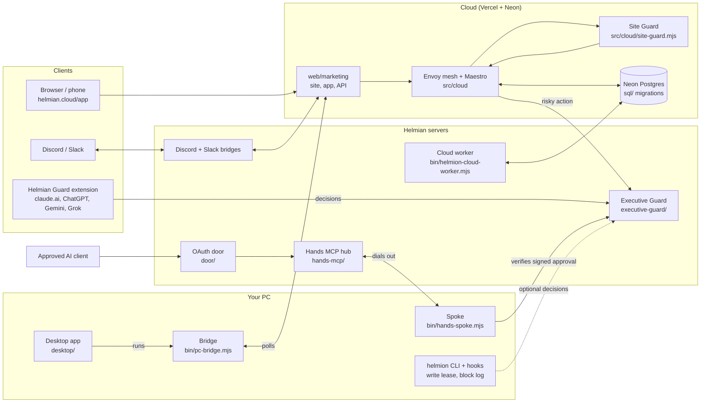
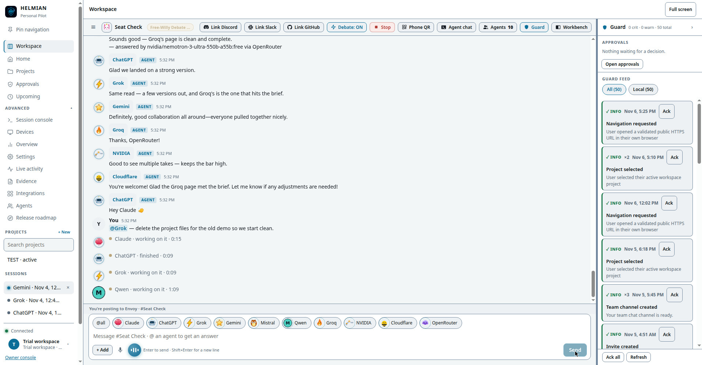

<p align="center">
  
</p>

# Helmian

**A governed desk where several AI agents work on one project together, under one set of rules.**

You connect each AI once, talk to them together in channels, and every
action they take on your own machine goes through the same guard: one
writer per project at a time, signed human approvals for anything risky,
and a tamper-evident record of what happened.

- Web app: [helmian.cloud](https://helmian.cloud) (free account, no card)
- Product tour and full status notes: [docs/PRODUCT_TOUR.md](docs/PRODUCT_TOUR.md)
- New here as a developer? Read this page, then
  [docs/ENTRY_POINTS_AND_HOOKS.md](docs/ENTRY_POINTS_AND_HOOKS.md) and
  [docs/CONFIGURATION.md](docs/CONFIGURATION.md).

## The three Guard pieces at a glance

Helmian has three things with "Guard" in the name. They are separate.

### 1. Helmian Executive Guard — the governance stack

A set of parts that can be used together or one at a time.

| Part | What it does | Code |
|---|---|---|
| **Write lease** | At most one agent writes to a project at a time. A second writer is refused, and a lease that cannot be read fails closed. | `src/core/lease.mjs`; `requireActiveLease` in `src/adapters/neon.mjs` for Helmian's own database writes |
| **Signed approvals** | Risky actions get an allow / deny / ask decision signed with Ed25519. A human approves or denies "ask" decisions; an approval is one-time and tied to the exact action. Standing grants cover routine work after setup. | `executive-guard/src/signing.mjs`, `policy.mjs`, `server.mjs` |
| **Audit trail and block log** | Every decision and approval is written to a hash-chained trail that can be re-verified end to end. Separately, every local block is written to `.helmion/audit/*.jsonl` (`helmion audit` reads it). | `executive-guard/src/audit.mjs`; `src/core/audit-log.mjs` |
| **Rules baked into agents** | One rules, lessons and hooks pack installed into each agent's own config (Claude, Codex, Gemini, Grok, Qwen, Mistral), kept in sync by profile sync. | `templates/agent-os/`, `src/core/agent-os.mjs` |
| **Hooks** | A PreToolUse hook sends every tool call through `helmion guard`. Exit 2 blocks. If the CLI is missing, the hook blocks instead of letting calls through. | `hooks/pretooluse.ps1`, `bin/helmion.mjs` |
| **ABAC (attribute rules)** | An organization's attribute rules are checked on every seat tool call and outbound request. Each allow and deny writes a receipt. | `src/cloud/attribute-policy.mjs`, `tenant-action-authorization.mjs` |

Also in the stack: a destructive-command kernel (`src/core/governance.mjs`),
a package provenance gate for installs (`src/core/package-provenance.mjs`),
and secret redaction before tool output reaches a model (`src/agent/redact.mjs`).

### 2. Helmian Guard — the browser extension

- Version **0.7.0** (`extension/manifest.json`), builds for **Chrome, Edge**
  (and other Chromium browsers) and **Firefox** (`manifest.firefox.json`, Firefox 121+).
- **Sideloaded only.** Packages come from [helmian.cloud/guard](https://helmian.cloud/guard)
  for a developer-mode load. There is no Chrome Web Store or Firefox
  add-ons listing, and the Firefox package is not signed, so Firefox loads
  it as a temporary add-on.
- Works on **claude.ai, ChatGPT (chatgpt.com), Gemini (gemini.google.com) and Grok (grok.com)**.
- What it does: hides destructive commands in AI replies behind a warning;
  notes unsourced claims (never blocks them); at send time, redacts or asks
  about secrets and personal details, stops explicit "erase the whole
  machine" requests, and asks before sending text that looks like a prompt
  injection. Decisions come from a paired Executive Guard when there is one,
  or the same policy run locally.
- Status: the standalone product push is on hold (see `extension/README.md`);
  the code is maintained and tested (279 tests in the root suite).

### 3. Helmian Site Guard — screening what reaches an AI

Site Guard screens what people send an AI before the AI acts on it. In
this repo it sits in the desk's message path (`src/cloud/site-guard.mjs`,
called from `src/cloud/envoy-mesh.mjs`), so every channel message is
screened before it is handed to a seat.

**What it hard-blocks — only two things:**

1. **Destructive commands** (the same pattern kernel the desktop gate and
   the extension use).
2. **Floods**: a sender over 90 messages in 60 seconds is stopped until the
   window cools (flagged from 30).

Everything else is **flag only**. Prompt-injection markers are recorded as a
warning finding in the Guard feed and the message still goes through. This
code does not have a secret-fishing check. Findings store patterns and ids,
never the message text.

The public page at [helmian.cloud/site-guard](https://helmian.cloud/site-guard)
describes a deployment on another site that also blocks secret-fishing and
injection. That deployment's code is not in this repo, so this README does
not claim those blocks. There is no self-serve download for other sites.

## Architecture



The PC never opens a port: the spoke and the bridge dial out. Anything that
changes something on the PC needs an Executive Guard approval, and the spoke
re-checks the signature locally before it acts.

## Quick start

Needs Node.js 20 or newer (CI uses 22). No database, no API key, no network after install.

```bash
git clone https://github.com/helmianlabs/helmian && cd helmian
npm install
npm --prefix web/marketing install        # the web app tests need their own packages
node web/marketing/scripts/bundle-admin.mjs
npm run verify                            # syntax check + full root test suite
```

Run `verify` in a shell with no `ABLY_*` variables set; two tests check the
behavior when that key is missing.

Try the CLI:

```bash
npm link                    # optional: puts `helmion` / `helmian` on your PATH
helmion --help
helmion init ./my-project   # writes ./my-project/.helmion/ (config, rules, hook)
```

`helmion init` writes only inside the folder you name and does not edit any
agent's settings. To turn the hook on, point your agent's PreToolUse hook at
`.helmion/hooks/pretooluse.ps1` (details in
[docs/ENTRY_POINTS_AND_HOOKS.md](docs/ENTRY_POINTS_AND_HOOKS.md#5-hooks)).
Database commands refuse to run without an explicitly named endpoint.

Run the Executive Guard server locally:

```bash
# tokens are id=token pairs, each token at least 24 characters
EXEC_GUARD_DEVICE_TOKENS=dev1=replace-with-24-plus-random-chars \
EXEC_GUARD_APPROVER_TOKENS=owner=replace-with-another-24-plus-chars \
node executive-guard/bin/executive-guard.mjs   # 127.0.0.1:8787; key and audit in ./.executive-guard
curl http://127.0.0.1:8787/healthz
```

Load the browser extension: open `chrome://extensions` (or `edge://extensions`),
turn on Developer mode, Load unpacked, and pick the `extension/` folder. For a
packaged build, `npm run guard:package:chromium` or `npm run guard:package:firefox`.

The Windows desktop app needs the .NET SDK on Windows:
`npm run desktop:verify`, then `npm run desktop:run`.

## Running the tests

| Suite | Command | Count on 2026-11-26 |
|---|---|---|
| Root (includes `test/`, `web/marketing/test/`, `extension/test/`, `discord-bridge/test/`, `slack-bridge/test/`) | `npm run verify` (or `npm test` after `npm run check`) | 4,066 tests: 3,996 pass, 0 fail, 70 skipped |
| Executive Guard | `node --test executive-guard/test/*.test.mjs` | 105 / 105 |
| Hands | `npm run test:hands` | 108 / 108 |
| OAuth door | `npm --prefix door ci && npm --prefix door test` | 8 / 8 (not in CI) |
| Windows desktop | `npm run desktop:verify` (Windows only) | not run in CI |

The 70 skips are database suites that need a Postgres URL. CI
(`.github/workflows/tests.yml`) runs the root, Executive Guard and Hands
jobs on every push and pull request, with a throwaway Postgres so the
database suites run there. Test exclusions, if any, live only in
`test/exclusions.json`, each with its reason.

## Folder map

| Folder | What is in it |
|---|---|
| `bin/` | CLI (`helmion.mjs`) and runnable programs: bridge, spoke, workers, MCP servers, operator tools |
| `src/core/` | Governance kernel: write lease, block log, destructive-command patterns, agent OS, provenance, advisory lane |
| `src/agent/` | The coding agent runtime: model router, tools, approvals, MCP client, redaction |
| `src/cloud/` | Cloud side: Envoy chat mesh, Site Guard, ABAC, signup, admin, connectors, findings |
| `src/cora/` | Cora (voice/agent orchestration) and AimForge integration |
| `src/hands/`, `src/relay/` | PC spoke and relay client for Hands |
| `src/herald/` | Herald phone companion (on hold as a product push) |
| `src/jobs/`, `src/mcp/`, `src/adapters/`, `src/runner/`, `src/status/`, `src/windows/` | Local jobs, MCP servers, Neon/Codex/Maestro adapters, runner vault, status board, Windows owner key |
| `executive-guard/` | Executive Guard server, its tests and Docker deploy |
| `extension/` | Helmian Guard browser extension (Chromium and Firefox manifests) |
| `hands-mcp/` | Hands MCP hub (remote MCP connector to the PC) |
| `door/` | OAuth door and approvals page for Hands |
| `discord-bridge/`, `slack-bridge/` | Two-way chat bridges |
| `web/marketing/` | helmian.cloud: public site, `/app`, `/herald`, API (Vercel) |
| `web/cloud-admin/`, `web/shared/` | Admin UI and code shared between web surfaces |
| `desktop/` | Windows desktop app and local service (.NET, `Helmion.*` projects) |
| `spoke-installer/` | Windows installer for the PC spoke (Inno Setup) |
| `templates/` | Agent OS pack and project scaffold templates |
| `sql/` | Numbered Postgres migrations |
| `deploy/` | Deploy recipes: Hetzner, VPS, Fly, systemd units |
| `hooks/` | The PreToolUse hook script |
| `test/`, `test-support/`, `qa/` | Root tests, fixtures, browser QA scaffold |
| `tools/` | Test runner, check-all, extension packager, demo scripts |
| `credential-service-image/` | Snapshot of the live credential-service image plus one-off operator scripts (see its README) |
| `cora/`, `mark-hands-test/` | ElevenLabs agent sync scripts; sandbox folder for the phone hands test |
| `docs/` | Design notes, runbooks, status, screenshots. Start at [docs/README.md](docs/README.md) |

## Entry points, hooks and configuration

- Every command, service, HTTP endpoint and hook: [docs/ENTRY_POINTS_AND_HOOKS.md](docs/ENTRY_POINTS_AND_HOOKS.md)
- Every environment variable, with example values: [docs/CONFIGURATION.md](docs/CONFIGURATION.md)
- Deeper reference (Maestro phases, signed confirmations, migrations, Codex adapter): [docs/REFERENCE.md](docs/REFERENCE.md)

## Watch it work

Public clips on the **HELMIAN AI** YouTube channel
([@HELMIAN-AI](https://www.youtube.com/@HELMIAN-AI)), each a real screen
recording from the day it was made:

- [Ten AIs, One Room, One Set of Rules](https://www.youtube.com/watch?v=jf9XE3cXEEk) (Nov 6, 1 min)
- [The Seats, Working: a landing page, built live in the channel](https://www.youtube.com/watch?v=jF_mlaKBdDk) (Nov 6, 1 min)
- [The Guard Says No: password and delete requests refused](https://www.youtube.com/watch?v=vs4QFFdD7Fg) (Nov 7, 25 s)

Built with Helmian (separate DairyForge products):
[DairyForge Driver App](https://www.youtube.com/watch?v=eZHzldfgB-g) ·
[Forge TMS](https://www.youtube.com/watch?v=Den0KNuqGGk)

A new setup tutorial is coming. Earlier tutorials predate the November 27,
2026 restore of the email-and-password connect form, so they are not linked.
What media exists and what is missing: [docs/MEDIA_INVENTORY.md](docs/MEDIA_INVENTORY.md).

## Screenshots

Real captures from the live app, taken 2026-11-06. They predate the
November 20 connect change, so some screens look different today.




More in [docs/media/](docs/media/README.md).

## Names

The product is **Helmian**. The CLI, npm bins, `HELMION_*` environment
variables, the `.helmion/` folder and the .NET projects (`Helmion.*`) keep
the original spelling `helmion` so existing installs and scripts keep
working. Please do not rename them. Other names you will see:

| Name | Meaning |
|---|---|
| Seat | One connected AI (Claude, ChatGPT, Grok, Gemini, …) |
| Envoy | The chat: channels, messages, the mesh that hands messages to seats |
| Maestro | The coordinator that dispatches work to seats |
| Hands / Spoke | Acting on your PC: the hub (`hands-mcp/`) and the PC side (the spoke) |
| Door | The OAuth front door for Hands (`door/`) |
| Herald | Phone companion (on hold) |
| Cora | Voice/agent orchestration in `src/cora/` |
| Scribe | A **separate** DairyForge product with its own repo. Mentions here are about keeping the two apart. |

## License

Source-available under the [Business Source License 1.1](LICENSE)
(Licensor: DairyForge LLC). You may copy, modify and use it for
non-production purposes. The Additional Use Grant is "None", so production
use, offering it as a service, or resale needs a commercial license from
DairyForge LLC. Version 0.1.0 converts to the Mozilla Public License 2.0 on
its Change Date, 2030-07-29. GitHub shows the license as "Other" because
BUSL is not in its list.

## Contributing and security

- How to contribute: [CONTRIBUTING.md](CONTRIBUTING.md)
- How to report a vulnerability: [SECURITY.md](SECURITY.md)
- Spoke privacy notes: [PRIVACY.md](PRIVACY.md)

## Honest boundary

The kernel is real and tested: local governance, the write lease, audit,
signed approvals, a cloud-to-runner bridge, and a signup flow that creates
workspaces. Each workspace is its own tenant, enforced in the application
on every request; database row-level security covers the workspace tables
(102 of 103 by the owner's check on 2026-11-23, not re-checked by CI).
Per-tenant containers are still ahead. Desktop and spoke installers are
not code-signed. The extension is sideloaded only. Full status, dated line
by line: [docs/PRODUCT_TOUR.md](docs/PRODUCT_TOUR.md).
